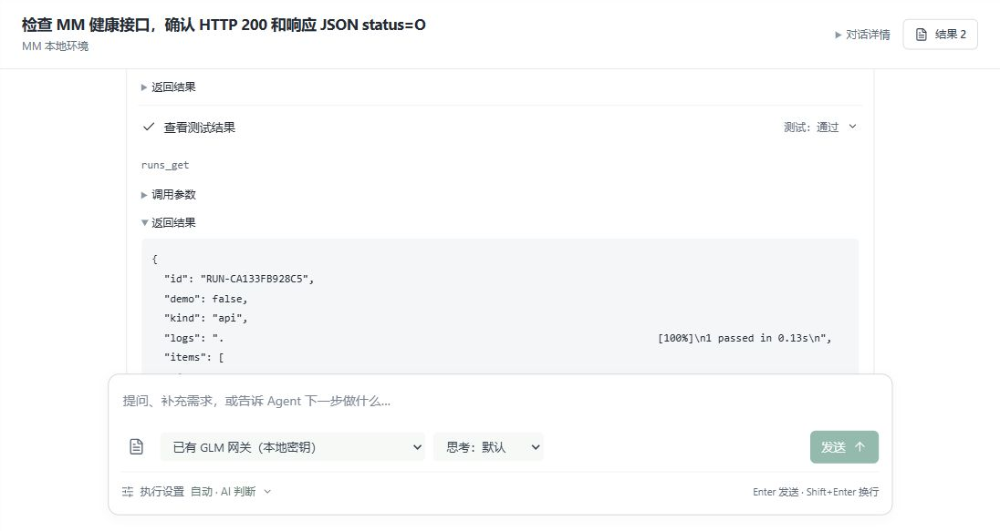
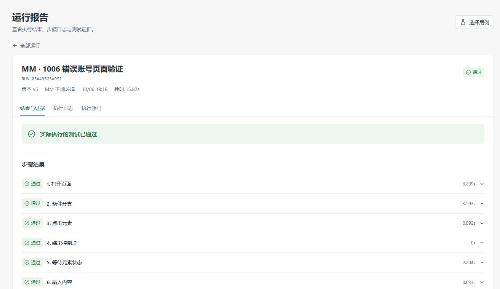
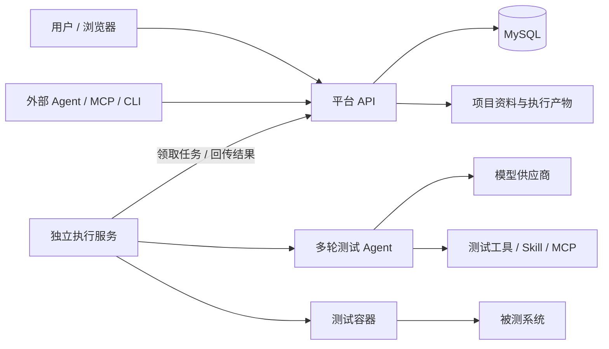

# AIQA

**让 AI 使用真实测试工具，完成从需求到测试结果的完整流程。**

AIQA 是一个支持 API、Web UI、JMeter 性能和 Android APP 的测试平台。你可以在界面中编排步骤、执行测试，也可以与内置 Agent 对话，让它读取需求、观察页面、编写用例、执行、查看证据并修订。生成的用例会保存为可编辑、可复跑的测试资产。

[实测演示](#实测演示) · [核心能力](#核心能力) · [快速开始](#快速开始) · [外部接入](#外部接入) · [开发与验证](#开发与验证)

## 实测演示

### 从一句需求到接口测试报告



输入测试目标后，Agent 读取 Skill 和项目资料，查询步骤能力，保存“请求 → 断言”的可视化用例，启动真实测试，再读取报告总结结果。截图展示 Agent 调用 `runs_get` 读取实际测试结果。在聊天界面中可展开工具参数和返回值，也可以打开生成的用例继续编辑。

这次执行包含 **6 次模型决策、7 次工具调用**。测试实际请求 MM 的 `/api/v4/system/ping`，检查 HTTP 200 和 JSON `status == "OK"`，最终 **1 条测试通过**。

### 先看页面，再编写 Web 回归



Agent 通过 browser-use 观察 MM 登录页面，再保存可视化步骤并执行 Playwright 用例。这个任务经历了多次定位修订：v1–v4 失败，用户在后续对话中补充定位线索后，Agent 修订为 v5 并实际通过；失败记录和截图仍然保留。验证的是“不存在账号登录被拒绝”，不是有效账号登录成功。

**演示说明：**以下是两个真实已完成任务的页面截图，分别展示 Agent 读取接口测试结果、Web 用例的最终运行报告。结果来自实际执行，没有使用模拟模型。截图只保留演示内容，去除了账号菜单和其他对话列表。下列 ID 与[导出的执行证据](assets/demo/agent-demo-evidence.json)对应；它们属于演示环境，新安装不会自动包含这些历史任务。

| 演示 | Agent 任务 | 用例 | 最终通过的运行 |
| --- | --- | --- | --- |
| 接口闭环 | `TASK-975F7A4F8A11` | `TC-24920869B7A5`，可视化 v1 | `RUN-CA133FB928C5` |
| Web 观察与修订 | `TASK-8AA232ACC9CA` | `TC-64E58256D941`，可视化 v5 | `RUN-05A49523A991` |

## 核心能力

| 能力 | 可以做什么 |
| --- | --- |
| 持续对话的 Agent | 多轮调用工具、读取结果后继续决策；追加要求、停止任务、恢复进度；展开每次工具调用 |
| 可视化用例 | 编排请求、操作、变量提取、断言、条件和循环；预览对应 Python/JMX；保留原生脚本入口 |
| API 测试 | pytest + HTTPX；请求头、查询参数、JSON/表单/文件上传、变量关联与响应检查 |
| Web UI 测试 | Playwright；元素定位、自动等待、页面断言、截图、Trace 和会话内网络请求记录 |
| AI 页面观察 | browser-use 独立探索页面，为后续编写回归提供定位和交互证据 |
| 性能测试 | JMeter；可视化生成或导入 JMX、CSV 参数化、单用户验证、负载阶段、P95/P99 与失败率检查 |
| Android APP 测试 | Appium + UiAutomator2；应用与设备管理、截图和元素观察、可视化步骤、设备独占与执行报告 |
| 项目资料与附件 | 保存需求和接口说明；聊天附加 PDF、DOCX 等文档；Agent 按需分页读取正文 |
| Skill 与 MCP 扩展 | 导入自定义 Skill、连接外部 MCP；说明书按需读取，工具由 Agent 选择调用 |
| 模型与权限 | 多模型切换、支持的思考深度、只读/自动/免确认模式；自动模式由 AI 判断是否需要人工批准 |
| 执行证据 | 用例版本、源码哈希、环境快照、步骤结果、日志、截图和指标；保存后无需模型即可复跑 |

内置 Agent 默认优先生成可视化步骤，确有能力缺口或用户明确要求时才使用整份脚本。人和 Agent 操作同一套用例、版本和报告。

## 架构



- **平台 API**负责身份、项目、资产、任务和结果，HTTP 请求进程不运行 Agent 循环。
- **执行服务**负责运行 Agent、浏览器探索和测试任务；测试代码进入独立容器执行。
- **MySQL**保存平台记录，执行服务的 SQLite 保存任务缓存与 Agent 恢复点，文件目录保存资料和证据。
- **外部 Agent**通过 MCP 或 CLI 直接使用测试器，也可以使用自己的模型与浏览器工具。

技术栈：Python 3.12 · FastAPI · SQLAlchemy · MySQL · LangChain Agent / LangGraph 恢复点 · HTTPX · Playwright · browser-use · JMeter · Appium · Vue 3 · TypeScript · Docker。

## 快速开始

### 从源码启动

准备 Linux，或 Windows + Ubuntu WSL；安装 Docker Engine/Compose、Node.js 22.6+ 和宿主机 Python 3。运行时的 Python 3.12、测试依赖与 Chromium 随 Docker 镜像构建。

在仓库目录执行：

```bash
bash scripts/start.sh --local
```

打开 **http://127.0.0.1:8020**，本地模式无需登录。首次启动会构建前端和镜像、生成私有配置并启动数据库、API 和执行服务。

1. 在“项目与环境”创建项目，填写被测系统地址和测试容器可访问的地址。
2. 在“设置 → 模型”添加模型地址、模型 ID 和 API Key，测试连接。
3. 在“运行环境”检查执行服务与浏览器依赖。
4. 上传项目资料，在“Agent 工作台”发送测试目标。
5. 展开工具调用，打开生成的用例和报告；继续对话或手动调整步骤。

OpenRouter 免费模型预设仍需要用户自己的 API Key；免费模型、额度和可用性由供应商决定。Web 页面观察需要模型支持图片输入和工具调用。

可以从这样的要求开始：

> 读取当前项目资料，针对健康检查接口编写一条用例，验证 HTTP 状态和响应字段。保存后实际执行，等待报告，再告诉我检查了什么、结果如何。

> 先观察登录页面，验证不存在账号登录被拒绝。保存 UI 用例并执行；失败时先看截图和日志，再修订和复测。

Agent 只能执行已配置、可访问的环境；测试前应准备明确的验收要求和可用测试数据。`examples/` 提供 MM 接口、Web、JMeter 和 Android 示例，MM 被测服务需要另外部署。

### 成品包与双模式

成品包使用预构建镜像，安装者不需要项目源码、Node.js 或宿主机 Python。当前仓库提供打包脚本，尚未发布公共镜像地址或可直接下载的托管 Release。

| 模式 | 登录 | Agent 和测试运行位置 | 适合场景 |
| --- | --- | --- | --- |
| `local` | 免登录，固定本地工作空间 | 安装 AIQA 的电脑 | 个人使用、本机测试、内网目标 |
| `server` | 管理员创建账号，用户登录 | 部署 AIQA 的内网服务器 | 团队共享平台、浏览器访问 |

获得离线成品包并解压后：

```bash
# 本地部署
bash install.sh --offline

# 公司内网服务器部署
bash install.sh --offline --mode server
```

Windows 可使用 `./install.ps1 -Offline`。模式在安装时确定；源码开发启动默认只暴露回环端口，团队访问使用成品包的 server 模式。安装脚本位于 `deploy/package/`，依赖 Docker/Compose。停止服务使用 `docker compose --env-file install.env stop`，修复使用 `bash install.sh --repair`；两者保留数据。

### 目标地址与容器地址

容器里的 `localhost` 指容器自己。人用浏览器访问的目标地址，与测试容器实际使用的地址可以不同。

例如，被测服务与 AIQA 在同一 Docker 网络时，可登记浏览器地址 `http://127.0.0.1:8065`，执行地址 `http://mm-target:8065`。被测服务位于宿主机时，可以配置容器可达的 `host.docker.internal` 地址；位于公司内网时使用执行服务器能访问的内网地址。

JMeter 是独立组件；Android 模拟器还需要 KVM，真机需可用 Appium 节点和设备连接。运行环境页检查实际执行端，不检查浏览器访问者电脑上的 Python。

## 外部接入

AIQA 对外提供 **Streamable HTTP MCP、stdio MCP 和 CLI**。外部 Agent 负责决策，AIQA 负责存储、执行和返回真实证据，不会自动转交给内置 Agent。

HTTP MCP 地址：

```text
http://127.0.0.1:8020/mcp/
```

在 MCP 客户端中配置此地址。server 模式先在“设置 → 外部接入”创建 API Token；请求头使用：

```text
Authorization: Bearer <AIQA_API_TOKEN>
X-AIQA-Project: <PROJECT_ID>
```

典型调用链：

```text
project_context → steps_capabilities → cases_save_revision
                → runs_start → runs_get → artifacts_read
```

内置 Agent 可使用 `browser_explore`。当前对外 MCP 不直接开放 browser-use 或辅助命令执行，外部 Agent 可以用自己的浏览器工具观察页面，再调用 AIQA 保存、执行 Web 用例。

CLI / stdio 入口（需要 Python 3.12 环境安装本项目）：

```bash
pip install .
export AIQA_URL=http://127.0.0.1:8020
export AIQA_ACCESS_TOKEN='<AIQA_API_TOKEN>'
export AIQA_PROJECT_ID='<PROJECT_ID>'

aiqa status
aiqa environments
aiqa case list
aiqa run start "<CASE_ID>" 1 --environment "<ENVIRONMENT_ID>"
aiqa run get "<RUN_ID>" --wait 90
aiqa mcp serve
```

将尖括号中的占位符换成实际 Token 和 ID。访问 AIQA 的 API Token 与调用模型供应商的 API Key 是两种不同凭据。

## 开发与验证

```bash
# 启动或重建开发环境
bash scripts/start.sh --local --rebuild

# 独立数据库回归检查、前端测试与构建；不调用真实模型
python3 scripts/check.py

# 发布者生成离线包，可选附带 JMeter
python3 scripts/package_release.py --offline --performance

# 停止开发服务，保留数据
bash scripts/stop.sh
```

检查脚本需要运行中的 MySQL 和已构建的测试镜像。2026-10-07 验收通过 **211 项后端测试、2 项前端测试和生产构建**；本地/服务端成品安装均真实执行过 MM 接口、Web UI 和 JMeter 测试。

提交问题时，请提供部署模式、操作步骤、实际结果、预期结果和相关 Task/Run ID；提交改动时说明验证方式。不要上传 API Key、密码、访问令牌或包含敏感信息的截图和 Trace。

## 使用范围

目前面向个人与可信团队部署，已提供账号和项目成员隔离，不是面向不可信租户的托管 SaaS。执行服务持有 Docker 控制权限，应由可信维护者管理；测试容器本身不挂载 Docker socket，也不注入模型密钥或数据库凭据。

local 模式仅供本机访问；server 模式建议部署在内网并配置 HTTPS。模型 Key 按账号管理：本地存于本机执行目录，服务端存于加密凭据文件。备份时应同时保存数据库、资料/报告目录和执行器凭据。

性能首期使用单个发压节点，APP 首期支持 Android；扫描文档暂无 OCR。Agent 的探索和生成需要实际执行验证，不能仅凭回答文字判定测试通过。
